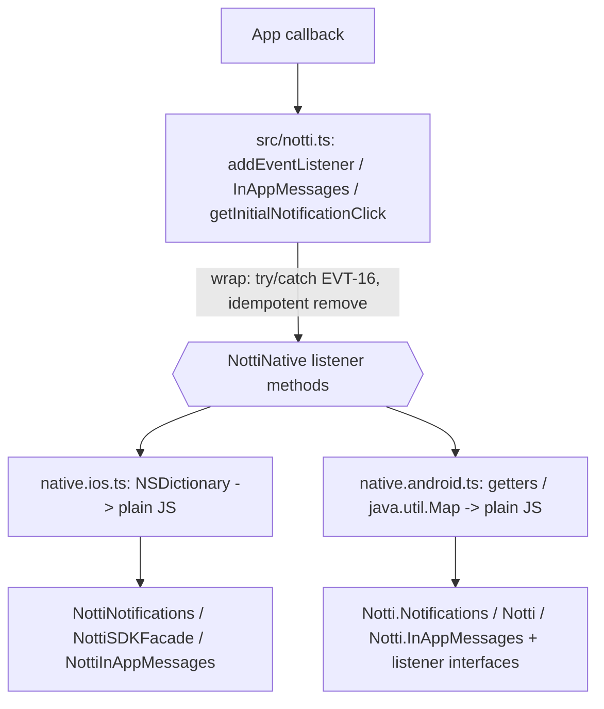

# Events and In-App Design

**Spec**: `.specs/features/events-and-in-app/spec.md`
**Context**: `.specs/features/events-and-in-app/context.md` (AD-012: on-demand native listeners)
**Status**: Draft

---

## Architecture Overview



Division of work:

- **Adapters** own platform mapping: native payload → plain JS objects already in the final shape (null rules,
  lowercase action type, unknown action → `null`). One native listener per call, native subscription returned.
- **Facade** owns platform-agnostic rules: event-name dispatch and `TypeError` (EVT-19), callback error isolation
  (EVT-16), idempotent `remove()` (EVT-02), `Promise` wrapper for the launch click.

No state is kept anywhere (AD-012): the facade does not track subscriptions.

---

## Seam additions (`src/native/types.ts`)

```typescript
export interface NativeSubscription { remove(): void }

export interface NotificationPayload {
  title?: string | null;
  body?: string | null;
  data?: { [key: string]: string };
}
export interface NottiInAppAction { type: 'url' | 'deeplink'; value: string }
export interface NottiInAppClick { messageId: string; buttonId: string; action: NottiInAppAction | null }

export interface NottiNative {
  // ...public-api methods...
  addReceivedListener(listener: (payload: NotificationPayload) => void): NativeSubscription;
  addClickedListener(listener: (payload: NotificationPayload) => void): NativeSubscription;
  addDeviceIdChangedListener(listener: (deviceId: string) => void): NativeSubscription;
  addInAppClickListener(listener: (click: NottiInAppClick) => void): NativeSubscription;
  /** Native `takeInitialClick()`, mapped; `null` when none. */
  takeInitialClick(): NotificationPayload | null;
}
```

Payload types live in `types.ts` and are re-exported publicly (single definition). Adapters always fill `title`,
`body`, `data` (EVT-13/14).

## Facade (`src/notti.ts`)

```typescript
addEventListener(name, callback): EventSubscription
  - 'notificationReceived' → native.addReceivedListener(guard(name, callback))
  - 'notificationClicked'  → native.addClickedListener(guard(name, callback))
  - 'deviceIdChanged'      → native.addDeviceIdChangedListener(guard(name, callback))
  - otherwise throw new TypeError(`[nativescript-notti] unknown event "${name}"; expected notificationReceived, notificationClicked or deviceIdChanged`)
  - returns once(nativeSubscription)
getInitialNotificationClick(): Promise<NotificationPayload | null>
  - async: return native.takeInitialClick()   (a sync native throw becomes a rejection)
InAppMessages.addClickListener(callback) → once(native.addInAppClickListener(guard('inAppClick', callback)))
```

- `guard(label, cb)`: `(arg) => { try { cb(arg) } catch (e) { console.error(`[nativescript-notti] ${label} listener threw`, e) } }`.
  Never logs the payload (may hold personal data).
- `once(sub)`: `{ remove: () => { if (!removed) { removed = true; sub.remove() } } }`. Safe to call inside a callback.
- Overloads typed like RN (`'deviceIdChanged'` → `(deviceId: string) => void`).

## iOS adapter (`native.ios.ts`)

| Seam | Native |
| --- | --- |
| `addReceivedListener` | `NottiNotifications.addReceivedListener(d => l(toPayload(d)))` |
| `addClickedListener` | `NottiNotifications.addClickedListener(...)` |
| `addDeviceIdChangedListener` | `NottiSDKFacade.addDeviceIdChangedListener(id => l(id))` |
| `addInAppClickListener` | `NottiInAppMessages.addClickListener(d => l(toInAppClick(d)))` |
| `takeInitialClick` | `const d = NottiNotifications.takeInitialClick(); return d ? toPayload(d) : null` |

The returned `NottiSubscription` already has `remove()`; returned as is.

Mapping (Obj-C dictionaries per `NottiObjC.swift` header: `title`/`body` absent when missing, `data` string map;
In-App `messageId`, `buttonId`, `action` = `{type, value}` or `NSNull`):

- `str(v)`: `typeof v === 'string' ? v : null` (covers absent key → `undefined`/`null` and `NSNull`, however the
  runtime marshals it [Incerto: whether `NSNull` reaches JS as `null` or as an `NSNull` instance; `str` handles both]).
- `toPayload(d)`: `{ title: str(d.objectForKey('title')), body: str(d.objectForKey('body')), data: toRecord(d.objectForKey('data')) }`.
- `toRecord(dict)`: if absent or not a dictionary → `{}`; else iterate `dict.allKeys` (`count`, `objectAtIndex(i)`) and copy
  string entries.
- `toInAppClick(d)`: `messageId`/`buttonId` via `objectForKey`, `action` = `toAction(d.objectForKey('action'))`.
- `toAction(a)`: `null` unless `a` is a dictionary whose `type` is `'url'` or `'deeplink'` and `value` is a string.

## Android adapter (`native.android.ts`)

| Seam | Native |
| --- | --- |
| `addReceivedListener` | `Notti.Notifications.addReceivedListener(new NottiNotificationListener({ onNotification: n => l(toPayload(n)) }))` |
| `addClickedListener` | `Notti.Notifications.addClickedListener(new NottiNotificationListener(...))` |
| `addDeviceIdChangedListener` | `Notti.addDeviceIdChangedListener(new NottiDeviceIdListener({ onDeviceIdChanged: id => l(id) }))` |
| `addInAppClickListener` | `Notti.InAppMessages.addClickListener(new NottiInAppClickListener({ onClick: c => l(toInAppClick(c)) }))` |
| `takeInitialClick` | `const n = Notti.Notifications.takeInitialClick(); return n ? toPayload(n) : null` |

Mapping:

- `toPayload(n)`: `{ title: n.getTitle() ?? null, body: n.getBody() ?? null, data: toRecord(n.getData()) }`.
- `toRecord(map)`: `{}` when null; else `entrySet().iterator()` and copy `getKey()`/`getValue()` (both `String` per the
  SDK type).
- `toAction(a)`: `null` when null; else `a.getType().name().toLowerCase()`, kept only if `url`/`deeplink`, with
  `a.getValue()`.
- Interface implementations use the `new Interface({...})` form, same as `NottiPermissionCallback` in `public-api`
  (runtime proof pending B-001).

## Public exports

`index.ios.ts`/`index.android.ts`/`index.d.ts` add `NotificationPayload`, `NottiInAppAction`, `NottiInAppClick`,
`EventSubscription`, `NottiEventName`. `NottiApi` gains `addEventListener` (overloads), `getInitialNotificationClick`,
`InAppMessages`.

## Tests

| File | Covers |
| --- | --- |
| `test/notti.test.ts` | dispatch per event name; `TypeError` on unknown name; callback errors caught with `console.error` and no payload in the log, other listeners unaffected; `remove()` idempotent and safe inside callback; duplicates not deduped; `getInitialNotificationClick` resolves value/null and rejects on throw; In-App path |
| `test/native.ios.test.ts` | fake `NSDictionary` (`objectForKey`, `allKeys`); title/body absent → null; `NSNull`-like and `null` handled; data copy and `{}`; action url/deeplink/other/NSNull; each listener method calls the right Obj-C class and returns its subscription; takeInitialClick null/value |
| `test/native.android.test.ts` | fake `NottiNotification` getters and `java.util.Map` with `entrySet().iterator()`; enum `name()` mapping; unknown type → null; listener interfaces constructed and wired; takeInitialClick null/value |

## Error Handling

| Scenario | Handling | User impact |
| --- | --- | --- |
| App callback throws | caught, `console.error` (label + error, no payload) | other listeners keep working; app does not crash |
| Unknown event name (plain JS) | `TypeError` at `addEventListener` | programming error surfaces immediately |
| Native class missing | sync throw (listeners) / rejection (`getInitialNotificationClick`) | install problem visible |

## Tech Decisions

| Decision | Choice | Rationale |
| --- | --- | --- |
| Mapping location | adapters | platform shapes differ; facade stays platform-agnostic |
| Error isolation | facade | one implementation for all events on both platforms |
| `NSNull` handling | `typeof === 'string'` checks | robust to either marshalling, no runtime assumption |
| Subscription | native object wrapped by `once` | no plugin state; idempotency without a registry |
