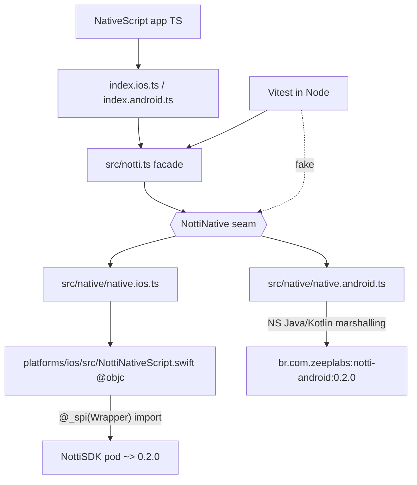

# Package Foundation Design

**Spec**: `.specs/features/package-foundation/spec.md`
**Status**: Approved

Research sources (2026-11-07): npm tarballs `nativescript@9.1.2`, `@nativescript/android@9.1.1`,
`@nativescript/ios@9.1.0`, `@nativescript/template-blank-ts@9.1.1`, `@nativescript/firebase-core@5.0.2`,
`@nativescript/firebase-messaging@5.0.2` (CLI and runtime source read directly, file:line in the
research notes below); Maven Central `notti-android-0.2.0.aar` and `.pom`; sibling repos.
Confidence tags: [Certo] read in source, [Provável] strong inference, [Incerto] to be proved by a spike.

---

## Architecture Overview

All business logic stays in the native SDKs. The plugin has three layers:

1. **Facade** (`src/notti.ts`): pure TypeScript, no `@nativescript/core` import, no native globals.
   Validates and normalizes arguments, owns the JS-facing types, and calls the seam. Unit-tested in Node.
2. **Seam** (`src/native/types.ts`): the `NottiNative` interface. One implementation per platform:
   `native.ios.ts` calls the plugin's Swift shim; `native.android.ts` calls `com.zeeplabs.notti.*`.
3. **Native glue**: iOS Swift shim `platforms/ios/src/NottiNativeScript.swift` (the only way to reach the
   `@_spi(Wrapper)` initializer); Android needs no source, only `include.gradle`.



This feature ships only `initialize` end to end (smoke path). `public-api` grows the seam and facade.

---

## Code Reuse Analysis

### Existing Components to Leverage

| Component | Location | How to Use |
| --- | --- | --- |
| Seam + adapter pattern | RN `origin/main`: `ios/NottiNativeSDK.swift`, `android/.../NottiNativeApi.kt` | Same split (interface + default impl + fake in tests), but the seam lives in TS here |
| `SDK_VERSION` literal + sync script | RN `src/version.ts`, `scripts/sync-sdk-version.js` | Copy as is; literal avoids bundler self-require issues; test guards drift |
| Changelog extraction | RN `scripts/extract-changelog-section.js` | Copy for `release.yml` (in `example-and-release`) |
| commitlint/lefthook/release-it config | RN `package.json`, `lefthook.yml` | Same config; tag `v${version}`, `after:bump` sync hook |
| Version drift check idea | iOS `scripts/check-version*`, Android version drift job | New `scripts/check-native-versions.js` for Podfile vs `include.gradle` vs `package.json` |
| Swift-in-plugin layout | `@nativescript/firebase-messaging` 5.0.2 `platforms/ios/src/*.swift` + Podfile | Proven pattern for a plugin Swift file importing a pod from its own Podfile |

### Integration Points

| System | Integration Method |
| --- | --- |
| `NottiSDK` (iOS) | Plugin `platforms/ios/Podfile` adds `pod 'NottiSDK', '~> 0.2.0'` inside the app target block [Certo, `cocoapods-service.js`] |
| `notti-android` | `platforms/android/include.gradle` `dependencies { implementation ... }`, applied to the app module [Certo, `app/build.gradle:153-160`] |
| Backend | none in this feature; `sdk_name: "nativescript"` is rejected until M0 (AD-001), so spike runs use a dev `appId` and only check that the call returns |

---

## Components

### Package manifest and layout

- **Purpose**: installable `nativescript-notti` package (AD-002, AD-003).
- **Location**: repo root.
- **Layout**:

```
package.json            name nativescript-notti, main "dist/index", types "dist/index.d.ts",
                        files [dist, platforms, README.md, CHANGELOG.md, LICENSE],
                        peerDependencies @nativescript/core ">=9.0.0 <10",
                        "notti": { "ios": "0.2.0", "android": "0.2.0" }   (native version source of truth)
src/index.ios.ts        wires facade + iOS seam, re-exports public API
src/index.android.ts    wires facade + Android seam
src/index.d.ts          public type surface (hand-written, single source for both platforms)
src/notti.ts            facade (pure TS)
src/version.ts          SDK_VERSION literal
src/native/types.ts     NottiNative seam
src/native/native.ios.ts / native.android.ts
platforms/ios/Podfile
platforms/ios/src/NottiNativeScript.swift
platforms/android/include.gradle
typings/                generated .d.ts for NottiSDK shim and notti-android (ns typings), committed
demo/                   NativeScript Core TS app (template-blank-ts 9.1.x), depends on the plugin
scripts/                sync-sdk-version.js, check-native-versions.js
```

- **Notes**: `main: "dist/index"` relies on the NativeScript bundler resolving `index.ios.js` /
  `index.android.js` by platform suffix [Provável; proved in spike S5]. Peer range starts at 9.0 because
  everything was verified against 9.1 sources; widening to 8.x is not a goal.

### Facade (`src/notti.ts`)

- **Purpose**: the JS API; in this feature only `initialize`.
- **Interfaces**:
  - `createNotti(native: NottiNative): NottiApi`
  - `NottiApi.initialize(appId: string, clientKey: string, options?: { baseUrl?: string }): void`
- **Behavior**: trims nothing and invents no defaults the native SDKs already own; passes
  `baseUrl ?? null`, `SDK_VERSION`. Empty `appId`/`clientKey` follow RN's current behavior (decided in
  `public-api`; here it just forwards).
- **Dependencies**: `NottiNative`, `SDK_VERSION`. No `@nativescript/core`.

### Seam (`src/native/types.ts`)

```typescript
export interface NottiNative {
  /** Calls the native wrapper initializer with sdkName "nativescript" and opensInAppURLs false (AD-004). */
  initialize(appId: string, clientKey: string, baseUrl: string | null, sdkVersion: string): void;
}
```

`sdkName` and `opensInAppURLs` are fixed inside the adapters, not parameters: no caller may change them.

### iOS adapter + Swift shim

- **Swift** (`platforms/ios/src/NottiNativeScript.swift`):

```swift
import Foundation
@_spi(Wrapper) import NottiSDK

@objc(NottiNativeScript)
public final class NottiNativeScript: NSObject {
  @objc public static func initialize(appId: String, clientKey: String, baseUrl: String?, sdkVersion: String) {
    Notti.initialize(appId: appId, clientKey: clientKey,
                     options: Notti.Options(baseUrl: baseUrl, opensInAppURLs: false),
                     sdkName: "nativescript", sdkVersion: sdkVersion)
  }
}
```

  Only Obj-C representable types cross the boundary (`NSString`, `NSDictionary`, blocks) [Certo].
  The class name is unique (`NottiNativeScript`), so it never shadows `NottiSDK.Notti` or `NottiBridge`.
- **How it builds** [Certo]: the CLI adds `platforms/ios/src` to the app's first target
  (`ios-project-service.js:545-551,710-727`); `nsld.sh` generates a modulemap over the app's
  `*-Swift.h` so the metadata generator exposes `@objc` classes to JS.
- **Risk** [Incerto]: the app template sets `SWIFT_VERSION = 4.2`. The shim must compile in that language
  mode, or the README must ask apps to set `SWIFT_VERSION = 5.0` in `App_Resources/iOS/build.xcconfig`
  (a plugin cannot set it cleanly). Spike S1.
- **TS** (`native.ios.ts`): `NottiNativeScript.initializeWithAppIdClientKeyBaseUrlSdkVersion(...)`; the
  exact selector name comes from the generated typings, not from this doc.

### Android adapter

- **Gradle** (`platforms/android/include.gradle`):

```groovy
dependencies {
    implementation 'br.com.zeeplabs:notti-android:0.2.0'
}
```

- **TS** (`native.android.ts`): `com.zeeplabs.notti.Notti.initializeForWrapper(Utils.android.getApplicationContext(), appId, clientKey, options, 'nativescript', sdkVersion)`.
  `initializeForWrapper` is `@JvmStatic` [Certo, SDK source]; `@NottiWrapperApi` opt-in only blocks
  Kotlin callers [Certo]. `NottiOptions(baseUrl, opensInAppUrls)` has Kotlin default arguments; from
  JS both arguments are passed explicitly. Exact JVM names (`INSTANCE`, nested `Notti.User`) come from
  `ns typings android --aar` [Provável].
- **Toolchain facts**:
  - NativeScript Android 9.1.1 defaults: Gradle 8.14.3, AGP 8.12.1, Kotlin 2.4.10 (always applied),
    compileSdk/targetSdk 35, minSdk 21, JVM target 17 [Certo, `framework/gradle.properties`].
  - Template blank-ts 9.1.1 sets compileSdk 36, minSdk 24, targetSdk 36 in `App_Resources/Android/app.gradle` [Certo].
  - `notti-android-0.2.0.aar` metadata: `minCompileSdk=34`, `minAndroidGradlePluginVersion=1.0.0` [Certo,
    read from the published AAR]; POM: kotlin-stdlib 2.0.21, firebase-messaging 25.1.2, okhttp 4.12.0,
    core-ktx 1.13.1, lifecycle-process 2.6.2, activity 1.7.0.
  - Result: no AGP 9 requirement; Kotlin 2.4 reads 2.0 metadata. The only host constraint is
    **minSdk 24** (manifest merger fails below it). README states it; the plugin does not override it.
  - Local builds need JDK 17 (Gradle 8.14.3 does not run on the default JDK 25 here); CI uses Temurin 17.

### google-services (PKG-13)

The plugin never applies `com.google.gms.google-services` and ships no `buildscript.gradle`. The app owns
it, either directly (classpath in `App_Resources/Android/before-plugins.gradle` or `buildscript.gradle`,
`apply plugin` in `app.gradle`) or through `@nativescript/firebase-core`, which applies it from its own
`include.gradle` [Certo]. Applying it twice is a conflict, so a plugin that does it would break apps
already on firebase-core. Exact JSON location (`App_Resources/Android/google-services.json` vs
`App_Resources/Android/src/`) and the behavior with no JSON are proved in spike S4 [Incerto].

### Version sources and drift check

- `package.json` `notti.ios` / `notti.android` = the native versions.
- `scripts/check-native-versions.js` fails when `platforms/ios/Podfile` (`~> X.Y.Z`) or
  `platforms/android/include.gradle` (`:X.Y.Z`) disagree with them, or when `src/version.ts` disagrees
  with `package.json.version`.
- iOS constraint `~> 0.2.0` (>= 0.2.0, < 0.3.0): patch releases flow in; a minor may change the SPI and
  needs a deliberate bump. Android is exact (Gradle has no `~>`; same as RN).

### Demo app (`demo/`)

- NativeScript Core TS app from `@nativescript/template-blank-ts` 9.1.x, one screen with an
  "Initialize" button calling the plugin and showing the result/log.
- Consumes the plugin as a local dependency. Which form works with pnpm and the NS CLI (`file:..`,
  `link:..`, or `npm pack` tarball) is proved in spike S5 [Incerto]; CI uses the same form.
- Holds no real credentials: `appId`/`clientKey` come from an untracked `demo/app/config.local.ts`
  (gitignored) with a committed `config.example.ts`.

### Tests

- Vitest (TS out of the box, no Babel; RN used Jest only because of the RN preset).
- `test/notti.test.ts`: facade with a fake `NottiNative` (records calls).
- `test/native.android.test.ts`: stubs `globalThis.com.zeeplabs.notti.Notti` and `Utils`, asserts
  `initializeForWrapper` gets `'nativescript'` and `opensInAppUrls false` (PKG-16).
- `test/native.ios.test.ts`: stubs `globalThis.NottiNativeScript`, asserts forwarded args.
- `test/version.test.ts`: `SDK_VERSION === package.json.version`.
- Native compile paths are covered by the demo builds, not by unit tests.

### Repo tooling

- pnpm pinned through `packageManager` (`pnpm@10.15.0`, same as RN; Corepack otherwise picks 12.x).
- `.nvmrc` same Node major as RN; TypeScript strict; ESLint flat config + Prettier (RN config minus RN
  presets); lefthook pre-commit (lint, typecheck) and commit-msg (commitlint); release-it config present
  but unused until `example-and-release`.
- `nativescript` CLI as a devDependency (`~9.1.0`), run via `pnpm exec ns` in `demo/`; no global CLI.

### CI (`.github/workflows/ci.yml`)

| Job | Runner | Runs |
| --- | --- | --- |
| lint | ubuntu | `pnpm lint`, `pnpm typecheck` |
| test | ubuntu | `pnpm test` |
| native-versions | ubuntu | `node scripts/check-native-versions.js` |
| build-android | ubuntu, Temurin 17 | `ns build android` in `demo/` |
| build-ios | macos | `ns build ios` (simulator) with the default `use_frameworks!` and with `use_frameworks! :linkage => :static` via `demo/App_Resources/iOS/Podfile` |

No secrets in any job (PKG-19). Note: the native SDK repos have CI blocked by Actions billing (their
B-002); if that applies to this repo, local runs are the evidence until it is fixed.

---

## Spikes (run first, in this order; each ends with an AD in STATE.md)

| ID | Question | Pass | If it fails |
| --- | --- | --- | --- |
| S1 | Swift shim with `@_spi(Wrapper) import NottiSDK` compiles and is callable from TS under the template's `SWIFT_VERSION 4.2` | demo shows the shim return on a simulator | try `SWIFT_VERSION = 5.0` via `build.xcconfig` (document as required); else stop, propose shim as its own pod or xcframework, Julio decides |
| S2 | `-package-name NottiSDK` from the pod's `pod_target_xcconfig` survives both linkage modes | both builds green | record the failing mode as unsupported in README; or fix via plugin `post_install` |
| S3 | `notti-android` resolves and `initializeForWrapper` is callable from TS with NS 9.1 defaults | emulator run, no crash, `ns typings android` names confirmed | record required `app.gradle` overrides |
| S4 | google-services: JSON location; build and launch with no JSON | documented working setup; no-JSON behavior known | document the failure mode |
| S5 | local plugin consumption from `demo/` with pnpm + NS CLI, including platform-suffix `main` resolution | demo picks up plugin TS and native files after a change | fall back to `npm pack` tarball install in demo and CI |

---

## Error Handling Strategy

| Error Scenario | Handling | User Impact |
| --- | --- | --- |
| Native call throws in an adapter (e.g. class not linked) | Let it throw; no try/catch that hides a broken install | Developer sees the native error at `initialize` |
| iOS deployment target < 15.0 | CocoaPods error from `NottiSDK`; README states 15.0+ (template is 16.0) | Build fails with a clear pod message |
| Android minSdk < 24 | Manifest merger error; README states 24+ | Build fails with a clear Gradle message |
| `sdk_name` rejected by backend (before M0) | Native SDK logs and skips that field (its spec) | Only during development |

---

## Tech Decisions (only non-obvious ones)

| Decision | Choice | Rationale |
| --- | --- | --- |
| Where the seam lives | TS interface, adapters in `*.ios.ts`/`*.android.ts` | NS calls native APIs straight from TS; only iOS SPI needs Swift |
| sdkName/opensInAppURLs | hardcoded in adapters | AD-001/AD-004 are invariants, not options |
| Test runner | Vitest | TS without Babel; nothing RN-specific to preset |
| iOS pod constraint | `~> 0.2.0` | patches flow, minors (possible SPI breaks) need a bump |
| google-services | never applied by the plugin | coexistence with `@nativescript/firebase-core`, which applies it itself |
| Typings | generated by `ns typings`, committed | real JVM/ObjC names instead of hand-written guesses |

---

## Spec adjustments from research

- **PKG-08**: NativeScript always emits `use_frameworks!` in the app Podfile [Certo, `cocoapods-service.js:23-24`].
  The two modes are therefore dynamic frameworks (default) and `use_frameworks! :linkage => :static`, not
  static libraries. Spec wording updated.
- **PKG-12**: research shows no AGP/Kotlin/compileSdk override is needed with NS 9.1 defaults; the remaining
  host constraint is minSdk 24. Kept as a spike check (S3), not as plugin code.

---

## Deferred to later features (found during research)

- `@nativescript/firebase-messaging` 5.0.2 replaces `UNUserNotificationCenter.current().delegate` on
  `didFinishLaunching` (keeping and forwarding to the previous one) and swizzles the APNs token callbacks
  via `GULAppDelegateSwizzler`; on Android it registers its own `FirebaseMessagingService`. Two services
  for `MESSAGING_EVENT` means only one receives messages. Coexistence design belongs to `push-integration`.
