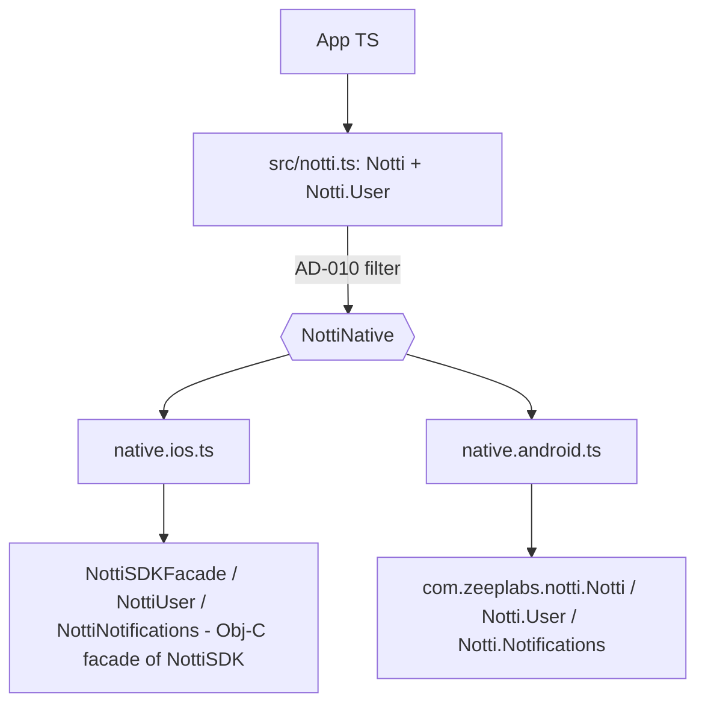

# Public API Design

**Spec**: `.specs/features/public-api/spec.md`
**Status**: Draft

Short design: the seam, facade and adapter pattern from `package-foundation` is reused as is. Only the
new decisions are written down.

---

## Architecture Overview



No Swift or Kotlin is added. The Swift shim stays limited to the wrapper `initialize`.

---

## Seam (`src/native/types.ts`)

```typescript
export interface NottiNative {
  initialize(appId: string, clientKey: string, baseUrl: string | null, sdkVersion: string): void;
  requestPermission(): Promise<boolean>;
  login(externalUserId: string): void;
  logout(): void;
  setSubscription(enabled: boolean): void;
  setLocationSharingEnabled(enabled: boolean): void;
  getDeviceId(): string | null;
  trackEvent(name: string): void;
  addTag(key: string, value: string): void;
  addTags(tags: Record<string, string>): void;
  removeTag(key: string): void;
  removeTags(keys: string[]): void;
  setEmail(email: string): void;
  clearEmail(): void;
  setPhone(phone: string): void;
  clearPhone(): void;
}
```

The seam is flat (one interface); the facade groups `User` methods for the public shape.

---

## Facade (`src/notti.ts`)

- `createNotti(native)` returns `NottiApi` = `{ initialize, requestPermission, login, logout, setSubscription,
  setLocationSharingEnabled, getDeviceId, trackEvent, User }` where `User` = `{ addTag, addTags, removeTag,
  removeTags, setEmail, clearEmail, setPhone, clearPhone }`.
- Methods are arrow functions closing over `native`, so destructuring works (API-18).
- Pure forwarding except AD-010, implemented as two small helpers in the facade:
  - `stringEntries(tags)`: keeps `[key, value]` where both are strings; for each dropped key logs
    `console.warn('[nativescript-notti] addTags: ignored tag "<key>": value is not a string')`. A non-string key
    cannot exist on a JS object (keys are strings), so only values are checked there.
  - `stringItems(keys)`: keeps string items; warns once per dropped item with its index (not its value).
  - The filtered object/array is forwarded even when empty (API-07).
- No normalization of `getDeviceId` here: adapters own the platform `nil`/`null` mapping (API-13). The facade
  returns what the seam returns.

## iOS adapter (`native.ios.ts`)

| Method | Call |
| --- | --- |
| `requestPermission` | `new Promise((resolve, reject) => { try { NottiNotifications.requestPermission(g => resolve(!!g)) } catch (e) { reject(e) } })` |
| `login`/`logout`/`setLocationSharingEnabled`/`trackEvent` | `NottiSDKFacade.*` |
| `getDeviceId` | `NottiSDKFacade.deviceId ?? null` |
| `setSubscription` | `NottiUser.setSubscription` (on iOS it lives in `User`) |
| `addTag` | `NottiUser.addTagValue(key, value)` |
| `addTags` | build `NSMutableDictionary` with `setObjectForKey(value, key)`, pass to `NottiUser.addTags` |
| `removeTags` | `NSArray.arrayWithArray(keys)` to `NottiUser.removeTags` |
| other `User` methods | `NottiUser.*` same name |

Explicit `NSMutableDictionary`/`NSArray` construction instead of relying on implicit JS→Obj-C marshalling: the
behavior is then visible and unit-testable with stubs. [Provável] implicit marshalling would also work.

## Android adapter (`native.android.ts`)

| Method | Call |
| --- | --- |
| `requestPermission` | `new Promise(...)` wrapping `Notti.Notifications.requestPermission(new com.zeeplabs.notti.NottiPermissionCallback({ onResult: g => resolve(!!g) }))`, sync throw → reject |
| `login`/`logout`/`setSubscription`/`setLocationSharingEnabled`/`trackEvent` | `com.zeeplabs.notti.Notti.*` |
| `getDeviceId` | `Notti.getDeviceId() ?? null` |
| `addTags` | `new java.util.HashMap<string, string>()` + `put`, to `Notti.User.addTags` |
| `removeTags` | `new java.util.ArrayList<string>()` + `add`, to `Notti.User.removeTags` |
| other `User` methods | `com.zeeplabs.notti.Notti.User.*` same name |

`!!g` coerces the JVM/Obj-C boolean to a JS boolean in both adapters.

## Public types (`src/index.d.ts`)

Re-exports `NottiApi`, `NottiUserApi`, `InitializeOptions` from `notti.ts`; JSDoc on `NottiApi` members carries
API-17 (pre-initialize), the location note and "trackEvent is matched on device, never sent to the server" (RN text).

## Tests

| File | Covers |
| --- | --- |
| `test/notti.test.ts` | forwarding for every method with a fake seam; AD-010 filter + warn text without values; empty batches; destructuring |
| `test/native.ios.test.ts` | each Obj-C call; dictionary/array built; promise resolve true/false, reject on throw; `deviceId` undefined/null → null |
| `test/native.android.test.ts` | each Kotlin call; HashMap/ArrayList built; callback resolve; reject on throw; null → null |

Stubs: `NSMutableDictionary`, `NSArray`, `java.util.HashMap`, `java.util.ArrayList` as small fake classes on
`globalThis`, same approach as package-foundation.

## Error Handling

| Scenario | Handling | User impact |
| --- | --- | --- |
| Native not linked (`ReferenceError`) | sync methods throw; `requestPermission` rejects | install problem visible at first call |
| Denied permission / before initialize | resolve `false` (AD-011) | app branches on the boolean |
| Non-string tag value | dropped + warn (AD-010) | other tags still sent |

## Tech Decisions

| Decision | Choice | Rationale |
| --- | --- | --- |
| Where AD-010 lives | facade | one implementation, tested once, platform-agnostic |
| Collections | explicit native construction | testable, no reliance on implicit marshalling |
| Seam shape | flat | adapters stay one-call-per-method; grouping is a public-API concern |
